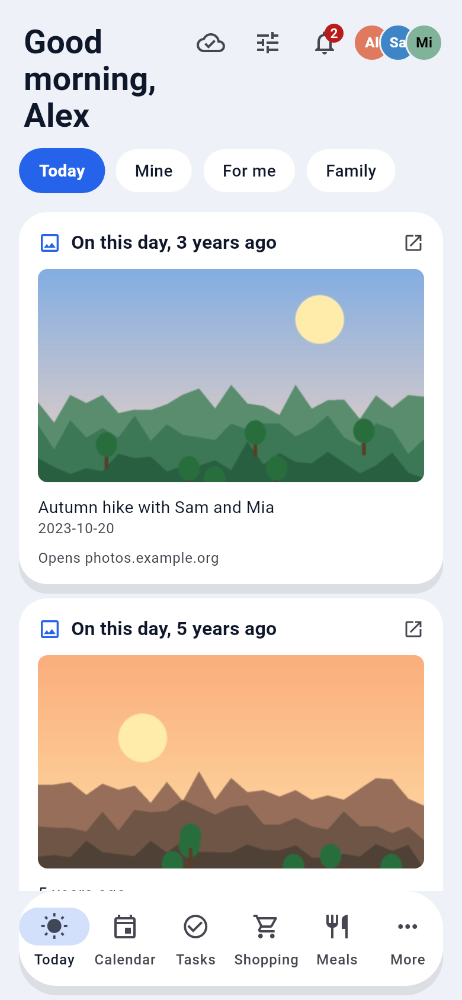
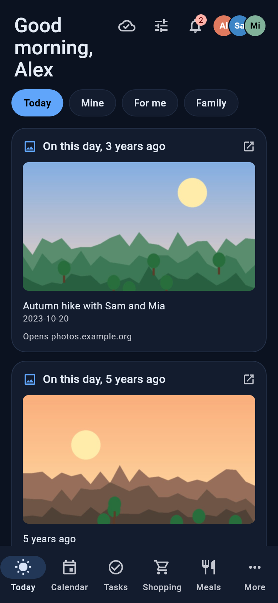

# Immich: On this day

A Familienhub plugin that shows photos from this day in earlier years on the **Today** screen ("On this day, 3 years ago"), taken from your self-hosted [Immich](https://immich.app) photo library.

| Light | Dark |
|---|---|
|  |  |

(Demo family and illustrations; no real photos.)

**Requires Familienhub 1.0.0-beta.3 or newer** (the Today-card hook and the image proxy). On older hubs the plugin shows as "not set up" with that message and does nothing.

## What it does

- One card per photo (up to the number you set, default 3): the title says how many years ago the photo was taken, with the photo's description (if Immich has one) and the date. Tapping the card opens the photo in Immich's web interface, but only when your Immich address is `https://`.
- Photos come from Immich's own "On this day" memories. Favourites are preferred, and different years are shown before a second photo of the same year.
- No card when there is nothing for today, or when Immich is down or not reachable. The Today screen never shows an error because of this plugin.
- Only photos are shown; videos are skipped.
- The result is cached for the day (and a failed lookup for two minutes), so opening the app does not call Immich every time.

## Settings

| Setting | Required | Meaning |
|---|---|---|
| `IMMICH_URL` | yes | Address of Immich as the **hub** reaches it, e.g. `https://photos.example.org` or `http://immich:2283`. No `/api` at the end (it is removed if you add it). |
| `IMMICH_API_KEY` | yes | An Immich API key, stored encrypted in the hub. |
| `IMMICH_ALBUM_IDS` | no | Comma separated album IDs to limit the photos to, e.g. your family albums. The ID is the last part of the album's address in Immich (`/albums/<id>`). Empty = the whole library. |
| `IMMICH_INCLUDE_ARCHIVED` | no | Also use archived photos. Default off. |
| `IMMICH_MAX_PHOTOS` | no | At most this many photos (cards) per day, 1 to 5. Default 3. |

### Creating the API key in Immich

1. In Immich open **Account settings** (your avatar, top right) and then **API keys**.
2. **New API key**, give it a name such as "Familienhub".
3. Select permissions. The plugin only reads, so the minimum is: `asset.read`, `asset.view`, `memory.read`, `album.read` (only if you use album filters), `server.about` and `user.read`. Choosing "All" also works.
4. Copy the key (Immich shows it once) into the plugin's settings.

The plugin acts as the **owner of the API key**: it sees that person's library, including photos shared with them. Use the key of the person (or a dedicated family account) whose photos the family should see, and use album filters if only some photos should appear.

### Test connection

*Test connection* checks the values as typed, before saving: it pings the server, asks `/api/users/me` with your key, and reads the server version. Typical results:

- `Connected as Alex, Immich 1.135.3`
- `Immich rejected the API key (wrong key or missing permissions: user.read)`
- `This address does not look like Immich. Check the address (no /api at the end)`
- `Immich is not reachable. Check the address (no /api at the end)` / `Immich did not answer in time. Check the address and network`

## Hosts contacted

Only your own Immich server, the address you enter in `IMMICH_URL`. The manifest lists no `hosts`, because the real host depends on your setup. Nothing else is contacted, there is no telemetry.

## Data read and written

- **Read from Immich:** today's memories (`GET /api/memories`), or on older servers `GET /api/assets/memory-lane`; with album filter or archived photos `POST /api/search/metadata` (one query per past year, up to 15 years); photo previews (`GET /api/assets/<id>/thumbnail?size=preview`); for the connection test `GET /api/server/ping`, `/api/users/me` and `/api/server/version`. Only photo metadata (id, date, favourite flag, description) is kept, in memory, for the day.
- **Written:** nothing, neither to Immich nor to the hub's database.

## Privacy

Photos stay in Immich. The hub only passes **previews** on to signed-in family members through its own route `/api/plugins/immich/thumbnail/<id>`, and only for the photos picked for today: the plugin keeps a whitelist in memory, anything else answers 404, so it is not an open proxy to your Immich. The app never learns the address of Immich or the API key. The API key is not written to logs or messages. All signed-in family members, including children and guests, see the same cards, so choose the API key and albums accordingly.

## Limitations

- How "today" is chosen: the hub server's local date; the photo's date is its local capture date as stored by Immich. 29 February only matches leap years.
- Immich memories can only be asked for the key owner's whole library. With an album filter or archived photos the plugin searches by date instead (more requests, up to 15 past years, all with a short timeout). If memories are empty (e.g. switched off in Immich), the plugin falls back to this search too.
- The Today screen allows one picture per card, so every photo is its own card (`on-this-day`, `on-this-day-2`, …). You can hide, move or resize them in the Today layout editor.
- If Immich does not answer within about 3.5 s, there is no card until the next try (after two minutes).
- Immich's API changes between versions. This plugin was written against the documented API of Immich 1.1xx/2.x (memories, search, assets) but has **not been tested against a running Immich server**, only against simulated responses. Please report differences.

## Development

```
cd plugins/immich
pip install pytest respx
DATA_DIR=$(mktemp -d) PYTHONPATH=/path/to/familienhub/backend pytest
```

MIT licensed.
