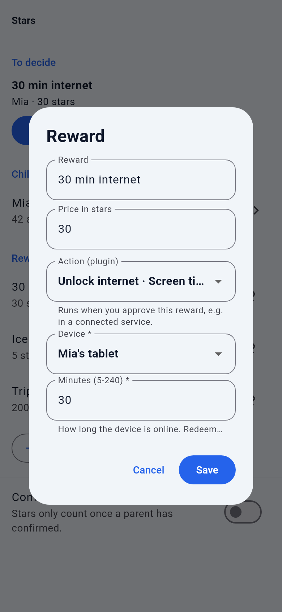
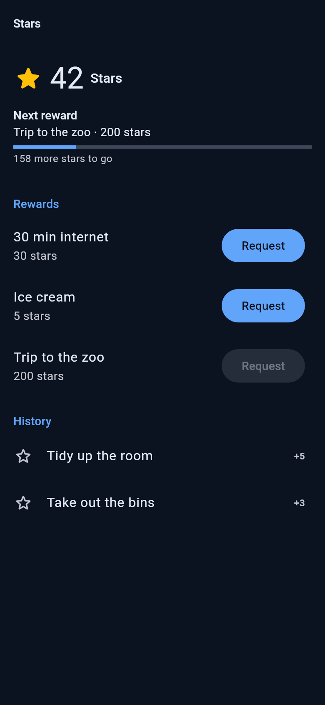

# Screen time as a reward (`screentime`)

A plugin for [Familienhub](https://github.com/Brottuetchen/familienhub). Kids collect stars, redeem them for "30 min internet", and when a parent approves, the plugin **unlocks the child's device for N minutes and blocks it again automatically**.

It works with the system you already have at home, chosen in the settings:

| System | How a device is blocked | Needs |
|---|---|---|
| **Fritz!Box** | TR-064 `X_AVM-DE_HostFilter` `DisallowWANAccessByIP` for the device's IPv4 address | a Fritz!Box user, fixed IP for the device |
| **AdGuard Home** | the device is put on / taken off the "disallowed clients" list (`/control/access/set`) | an AdGuard user, device IP or ClientID |
| **Pi-hole v6** | one Pi-hole *group* per device that blocks everything; the plugin enables (blocked) or disables (open) the group | an app password, a group per device |



## What it does

- **Reward action "Unlock internet"** (*More → Stars → reward → Action*): the parent picks the device and the minutes (5 to 240, default 30). On approval the device goes online, and the parent sees "Mia's tablet is online until 17:30". Redeeming again while the device is online **adds** the time (never more than 8 hours at once).
- **Automatic re-lock.** While the hub runs, the device is blocked again at the exact minute. A job every 5 minutes is the safety net: it also covers hub restarts, because the end times are kept in a file on the data volume.
- **Notifications.** The child gets "about 5 minutes left" (the job runs every 5 minutes, so that is approximate) and "Internet time is over", in the child's language (German or English). Parents are told when a device **could not be blocked again** (after the second failed attempt, then hourly while it lasts).
- **Today card for parents** ("Internet unlocked"): the devices that are online right now and the minutes left. Children never see it.
- **Test connection** in the install and settings screens, with the values you just typed: logs in, checks every device and reports whether each is currently blocked or online.



## Install and settings

*Administration → Store → Screen time as a reward → Install* (or paste the repository link, folder `plugins/screentime`). Needs Familienhub **1.0.0-beta.3** or newer; on older hubs the plugin stays inactive and says why.

| Setting | | |
|---|---|---|
| `SCREENTIME_BACKEND` | required | `fritzbox`, `adguard` or `pihole` (anything else is refused) |
| `SCREENTIME_URL` | required | Fritz!Box `http://fritz.box:49000` (or `https://fritz.box:49443`; the port is added if you leave it out). AdGuard Home `http://adguard.lan:3000`. Pi-hole `http://pi.hole` (a trailing `/admin` is removed) |
| `SCREENTIME_USERNAME` | Fritz!Box, AdGuard | leave empty for Pi-hole |
| `SCREENTIME_PASSWORD` | required, secret | Pi-hole: an **app password** |
| `SCREENTIME_DEVICES` | required | `Mia's tablet=192.168.178.42, Ben's Switch=192.168.178.50`. Name = what parents see (up to 40 characters, no `=`, `,` or `;`). The identifier depends on the system (below). At most 20 devices |
| `SCREENTIME_DEFAULT_LOCKED` | default on | on: the device is blocked again when the time is up. Off: the plugin never blocks anything itself; it only tells the child that the time is over (use it if a schedule on the router already does the blocking) |
| `SCREENTIME_VERIFY_TLS` | default on | switch off for `https://` with a self-signed certificate |

### Important: block the devices once, first

The plugin does **not** block a device on its own initiative. It opens it for a reward and closes it again afterwards. So a device is only "normally off" if you block it once in the system, using the steps below (the connection test tells you which devices are still online). Whatever you do by hand in the router stays as you set it, until a reward touches that device.

### Fritz!Box

1. **Home Network → Network → Network Settings → Home network sharing**: switch on **Allow access for applications** (this is TR-064).
2. **System → FRITZ!Box Users → Add user**. Give it a long random password, tick **FRITZ!Box settings** and nothing else. Do not tick "Access from the internet". (A dedicated user is better than your admin account.)
3. **Give the device a fixed IP:** *Home Network → Network → click the device → "Always assign this network device the same IPv4 address"*. The plugin identifies devices by IPv4 address.
4. Settings in the hub: backend `fritzbox`, address `http://fritz.box:49000`, the user, its password, devices `Mia's tablet=192.168.178.42`.
5. **Block the device once**: easiest is to redeem a 5-minute reward for it and let the plugin lock it when the time is up. Or block it by hand in the Fritz!Box (*Home Network → Network → the device → Edit → internet access blocked*, wording differs by FRITZ!OS version).
6. Run **Test connection**.

### AdGuard Home

The plugin uses AdGuard's access settings (*Settings → DNS settings → Access settings → Disallowed clients*). A client on that list gets **no DNS answers at all**, so it cannot open any site by name. The list is read first, only the device's entry is changed, the list is written back and read again to check it. Your other entries (also *Disallowed domains*) stay untouched. Other approaches were considered and rejected: `blocked_services` only blocks the services AdGuard knows by name, and a custom filter rule per client is not reliably applied to one client only.

1. *Settings → General settings*: make sure you have a user (*Settings → Users*; or the `users:` section in `AdGuardHome.yaml`). Use a dedicated user.
2. **Do not use "Allowed clients"**: if that list is not empty, everything not on it is blocked and the plugin cannot open anything. The connection test reports this as an error.
3. Identify the device: its **IP address** (reserve it in your router's DHCP), or a **ClientID** (letters, digits, `-`) if the device uses DNS-over-HTTPS/TLS with a ClientID in its address.
4. Devices: `Mia's tablet=192.168.178.42, Ben's Switch=ben-switch`.
5. Block the devices once by adding them to *Disallowed clients*.

### Pi-hole (v6)

Pi-hole has no "block this client" switch. The plugin uses what it has: **groups**. One group per device holds a deny rule for *everything*; the group is enabled (device blocked) or disabled (device open).

1. **Create the group:** *Groups → Add a new group*, e.g. `kids-mia` (the name is the device identifier in the settings, letters, digits, space, `_`, `.`, `-`).
2. **Create the client:** *Clients* → add the device (IP or MAC). In **Group assignment** select **only** `kids-mia` (remove *Default*). A client in no enabled group is not filtered at all, which is what "open" means.
3. **Create the block rule:** *Domains → Add domain*: type **Regex**, domain `.*`, **Deny**, group `kids-mia` only.
4. **App password:** *Settings → Web interface / API → Configure app password*. Enter it as the password (also works with two-factor login). Username stays empty. An app password is needed because the normal login may require 2FA, and sessions are limited: the plugin logs out after each use.
5. Devices: `Mia's tablet=kids-mia`.
6. The group is *enabled* when you finish, so the device is blocked. Run **Test connection**.

## Hosts, data and permissions

- **Contacts only the one address you enter** (your Fritz!Box, AdGuard Home or Pi-hole). The manifest's `hosts` list shows the usual default names (`fritz.box`, `pi.hole`, `adguardhome.local`) because the real address is yours. The hub only shows `hosts` to the installing admin, it does not enforce them: there is no installer support for "the address the admin types", and this plugin does not claim more than that.
- **Reads:** the access state of your configured devices, and the system's version.
- **Writes:** the block state of the configured devices only. It never edits anything else in the router or DNS server.
- **Stores:** `<DATA_DIR>/plugin-data/screentime/state.json` (device name, end time, the child's hub id and language, retry counter; mode 0600, no passwords or addresses). The password is stored by the hub, encrypted. The plugin never logs passwords or addresses, and error texts shown to parents contain neither.
- **Credentials:** one shared household account for the router or DNS server. It is not personal data of a child.

## Safety: what happens when something goes wrong

The rule is **when in doubt, block** (fail closed for the device), and **never fail silently**:

| Situation | What happens |
|---|---|
| Unlock fails (system down, wrong password) | Device stays blocked. The parent sees "Could not unlock Mia's tablet: ...". The stars stay paid (hub rule: a failing action never reverts the approval), so the parent can retry the unlock by hand in the router or redeem again. |
| Unlock worked but the answer got lost | The plugin writes a record that expires at once and blocks the device again on the next run. |
| Plugin cannot save its timer file | Nothing is unlocked. |
| Lock at the end fails | Retried every 5 minutes. After the 2nd failed attempt all parents get a notification, then again every hour. The device may stay online meanwhile: **this is the one fail-open case, and it is announced**. |
| Hub restarts while a device is unlocked | End times are in the state file; the job locks it as soon as the hub is up again (late by the downtime, at most). |
| Hub is down for the whole time | Nobody can lock: the device stays open until the hub is back. The plugin has no code on the router. For a hard limit, also use a schedule in the router. |
| Plugin switched off or removed while a device is unlocked | The hub runs no plugin code any more, so the device is **not** re-locked. Block it by hand. |
| A device is removed from the settings while unlocked | Parents are notified to check it. |

## Limitations (honest list)

- **Not a security product.** DNS blocking (AdGuard, Pi-hole) can be bypassed by a device with its own DNS server, DNS-over-HTTPS in the browser, a VPN, or cached/hard-coded addresses; apps may keep working a while after the lock because of caches (typically up to a few minutes). The Fritz!Box blocks by IPv4 address: a device with a random/changing IP must get a fixed one, and **IPv6 traffic may not be covered** (check *Internet → Filters*; consider switching IPv6 off for the home network, or use the Fritz!Box parental-control profiles in addition).
- A MAC address randomisation ("private Wi-Fi address") on the child's device changes its IP: switch it off for your home network.
- One unlock grant per device and moment: no per-app limits, no daily budget (the star price is the budget).
- End times are exact while the hub keeps running, and at most about 5 minutes late after a restart.
- Notifications are in English or German (the child's language); text for parents is bilingual.
- Pi-hole v5 and Fritz!Box on routers without TR-064 are not supported.

## What was tested, and what was not

All automated tests run against **simulated** systems (digest login, SOAP, REST, sessions, errors). **No real Fritz!Box, AdGuard Home or Pi-hole was available**, so these points follow the vendors' documentation but are not verified on hardware:

- Fritz!Box: that `GetWANAccessByIP` returns `NewDisallow`/`NewWANAccess`, that an unknown IP gives a SOAP fault, that the permission "FRITZ!Box settings" is enough, and that the block applies to the device at once.
- AdGuard Home: that `/control/access/set` takes effect immediately (documented: yes) and the exact field names of your AdGuard version (checked against v0.107).
- Pi-hole: the header `X-FTL-SID`, that `PUT /api/groups/{name}` is applied without a gravity update, and the group/regex setup above.

Please run **Test connection** after the setup, then redeem a 5-minute reward once, and report differences as an issue.

## Development

```
python -m venv .venv && . .venv/bin/activate
pip install -r /path/to/familienhub/backend/requirements.txt pytest respx
pip install -e .
DATA_DIR=$(mktemp -d) PYTHONPATH=/path/to/familienhub/backend pytest
```

MIT licence.
