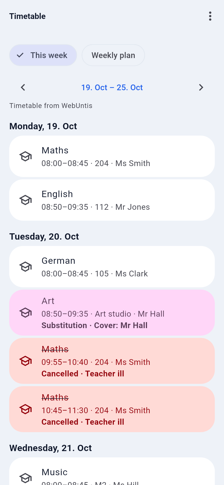
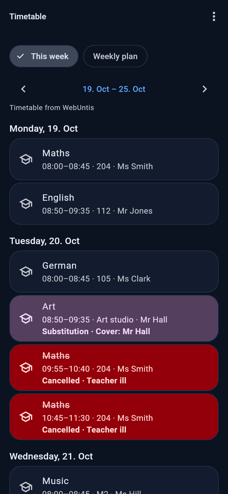

# WebUntis timetable and substitutions

A [Familienhub](https://github.com/Brottuetchen/familienhub) plugin for schools that use **WebUntis**. It fills each child's timetable in the hub automatically and sends a push notification when a lesson is **cancelled** or **substituted**.

| Light | Dark |
|---|---|
|  |  |

(Screenshots show a demo family with made-up lessons, rendered with the hub's real app.)

> **Status: not yet tested against a real WebUntis school.** The code is tested against a simulated server (115 tests), and the request and answer formats were checked against the source of an open-source WebUntis client (see [How this was verified](#how-this-was-verified)). Schools configure WebUntis differently; if your school's answer does not fit, the plugin shows nothing instead of failing, and the connection test tells you what it saw. Please report what you find.

## What it does

- **Timetable** (capability `timetable`): the lessons of each child for the week you look at, with room, teacher, the lesson's note, and the period number. Cancelled lessons are struck through, substitutions and changes are highlighted. They appear under *More → Timetable → This week* and on *Today* ("Mia: School until 13:15, 3rd–4th period cancelled"). Your own manual entries (sports, music, clubs) stay.
- **Push notifications** (every 15 minutes, only between 06:00 and 22:00 hub time): new cancellations and substitutions for today (and tomorrow, see *Days ahead*) go to the child's parents (roles partner and admin) and to the child, for example *"Mia: 3rd–4th period Maths cancelled tomorrow"* or *"Mia: 2nd period substitution (Art): Room R12, Cover: Mr Hall today"*. Consecutive periods of one subject are merged, a batch of several changes becomes one message per person. Texts are German or English, per recipient (their app language, German if unknown). Every person can switch the *Plugins* notification category off in the app.
- **People list** for the mapping: the students the account can see, as a dropdown.

## Set up

1. **Install** it from the store (*Administration → Store*), or by link: `https://github.com/Brottuetchen/familienhub-store/tree/main/plugins/webuntis`. Needs Familienhub **1.0.0-beta.3 or newer**; older hubs refuse the install, and if the files are put there by hand the plugin reports "needs Familienhub 1.0.0-beta.3 or newer" and stays inactive.
2. **Settings** (the install form, later *More → Administration → Plugins & access → WebUntis*):

   | Setting | Meaning |
   |---|---|
   | `WEBUNTIS_SERVER` (required) | The server of your school, e.g. `xyz.webuntis.com`. Without `https://` and without a path (a pasted address is shortened to the host). |
   | `WEBUNTIS_SCHOOL` (required) | The school's login name. |
   | `WEBUNTIS_USERNAME` (required) | Login of a **parent or student account**. |
   | `WEBUNTIS_PASSWORD` (required, secret) | Its password. Stored encrypted by the hub, never shown again. |
   | `WEBUNTIS_NOTIFY` (optional, default on) | Push on cancellations and substitutions. |
   | `WEBUNTIS_NOTIFY_DAYS` (optional, default 1) | How many days ahead to report: 1 = today and tomorrow, 0 = today only, at most 7. |

   Use **Test connection**: it logs in with the values you typed (before saving) and says, for example, *"Connected to my-school as parent.demo; students visible: 2"*.
3. **Map the children.** A parent opens *Timetable → menu → Timetable sources*, chooses **WebUntis** for each child and picks who the child is in WebUntis (the dropdown lists the students of the account).

### Where do I find server and school name?

Open your school's WebUntis login in a browser. The address looks like

```
https://xyz.webuntis.com/WebUntis/?school=my-school-city#/basic/login
        └──── server ────┘                └── school ──┘
```

The part after `https://` up to `/WebUntis` is the **server**, the value after `school=` is the **school**. (If your address shows the school in some other way, open the school's page on `webuntis.com`, search for the school and log in there; the address then contains both.) If the school name has special characters, copy it exactly as it appears in the address (`%20` is a space).

### Which account?

A **parent account** (one login that sees all its children) or a **student account** (sees itself) of the school. Ask the school office for access; the WebUntis app login of the parents works. A **teacher account is not suitable**: it has no students linked.

## Hosts contacted

Only the WebUntis server you enter (normally a `*.webuntis.com` host, listed in the manifest as `webuntis.com`; the hub does not enforce that list, it is information for the review). All requests are HTTPS, redirects are not followed, each request has an 8-second limit.

## What data is read and written

- **Read** from WebUntis: the login result (person id and type), the list of students of the account, the school's time grid (period times), and the timetable of the mapped students: date, times, subject, room, teacher, status and the school's notes. If the account may not read the timetable through the main interface, the web client's weekly timetable is read instead.
- **Written to WebUntis:** nothing. The plugin only logs in and out (it always logs out after a batch, as WebUntis asks).
- **Stored in the hub:** the settings (the password encrypted) and one small file `<DATA_DIR>/plugins/webuntis/state.json` with fingerprints (hashes) of the changes already reported, so nothing is announced twice; days in the past are removed from it. Lessons themselves are never stored: they are read on request and kept only in memory for 10 minutes. The hub's database is not touched.
- **Sent to others:** push notifications with the child's name and the change (through the hub's own notification service). Nothing leaves your hub except the requests to WebUntis.
- Passwords, user names and school names are never written to the hub log; the log only says what kind of failure happened ("credentials", "server"...).

## Good to know (limitations)

- **Whose credentials.** One account of the school is used for all children. It only sees what that account may see in WebUntis; whatever the school hides from parents is not shown.
- **School-specific permissions.** Some schools forbid parents to read the timetable through the main interface, hide teachers or rooms, or switch off substitution texts. Missing data is simply left out. Lists of subjects/rooms/teachers are only asked for when a lesson comes without names, and an answer of "no right" is ignored.
- **Period numbers** come from the school's time grid. Without it the notifications name the start time ("08:50") instead of "2nd period".
- **First run.** The first time the job sees a child it only remembers the current state, so installing the plugin does not flood anyone with old changes. Only changes that appear afterwards are pushed.
- **Not delivered = retried.** If a notification could not be sent (the hub allows 20 per hour per plugin), the change stays "new" and is tried again 15 minutes later.
- **Wrong password.** After a rejected login the plugin stops trying for 10 minutes, so a typo cannot lock the school account. Fix it in the settings.
- **Slow school server.** The hub waits 3 seconds for a timetable. A slower WebUntis server shows the last known data (or the manual entries) first; the request goes on in the background and the next view is complete. If WebUntis is down, data up to 6 hours old is shown.
- **Hub time.** "Today", "tomorrow" and the 06:00 to 22:00 window follow the hub's time zone setting.
- A change that is *undone* by the school (a cancellation withdrawn) is not announced.
- Vacations: days without lessons return nothing, so the hub shows your manual entries and its holiday handling as before.

## How this was verified

Checked against the source and typings of the open-source npm package `webuntis` 2.2.1 (SchoolUtils/WebUntis), which talks to real servers:

- JSON-RPC at `POST /WebUntis/jsonrpc.do?school=<school>`; `authenticate` with `user`, `password`, `client`; the answer with `sessionId`, `personType`, `personId`; the session as cookie `JSESSIONID` together with `schoolname=_<base64(school)>`; `logout`.
- `getTimetable` with `options.element {id, type}` (type 5 = student), `startDate`/`endDate` as numbers like `20261020`, `showInfo`, `showSubstText`, `showLsText`, `showLsNumber`, `showStudentgroup` and the `…Fields` lists; lesson fields `date`, `startTime`, `endTime`, `su`, `ro`, `te`, `kl`, `code` (`cancelled` or `irregular`), `substText`, `info`, `lstext`; times as numbers like `745`.
- Method names `getSubjects`, `getRooms`, `getTeachers`, `getTimegridUnits`; `GET /WebUntis/api/token/new` (a token string); `GET /WebUntis/api/public/timetable/weekly/data` with `elementType`, `elementId`, `date`, `formatId`.

**Assumed, not confirmed** (written from the task description and from memory of the WebUntis API, covered by tests that only prove the plugin matches these assumptions):

- Error codes: `-8504` bad credentials, `-8520` not authenticated (session expired), `-8509` no right. Other codes count as a generic error. How a wrong *school name* is answered (the plugin treats a redirect, HTTP 404, an error message that mentions the school, or a non-JSON answer as "check server and school").
- That a parent account's students are in `GET /WebUntis/api/rest/view/v1/app/data` (with the token from `/api/token/new` as Bearer) as `user.students[]` with `id` and a name, and that `getTimetable` accepts such a student id (element type 5) for a parent account. If a school does not allow it, the plugin falls back to the weekly web data when it gets "no right".
- The shape of the weekly web data (`data.result.data.elementPeriods`, `cellState` of `CANCEL`, `SUBSTITUTION` ...), the `orgid` marker for replaced rooms/teachers, and the time grid answer (`timeUnits` with numeric `name`).
- Parent accounts have `personType` 12 (the plugin does not depend on the number, it only treats type 5 as "a student account").

## For developers

```
familienhub-plugin.json       manifest (id webuntis, min_hub_version 1.0.0-beta.3)
pyproject.toml                package fh_plugin_webuntis, no dependencies (httpx comes from the hub)
fh_plugin_webuntis/
  plugin.py                   Plugin class: timetable, timetable_people, scheduled, test_settings, compatibility guard
  client.py                   small WebUntis client (JSON-RPC, session, re-login, logout), errors by kind
  parsing.py                  answers -> hub lesson dicts; host and time helpers
  messages.py                 notification texts (de, en) and the state file
tests/                        pytest + respx against a simulated WebUntis server
```

Run the tests with a checkout of the hub:

```
pip install pytest respx httpx fastapi sqlalchemy pydantic    # or the hub's requirements.txt
pip install -e .
PYTHONPATH=/path/to/familienhub/backend pytest -q
```

License: MIT.
